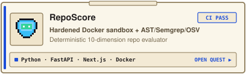
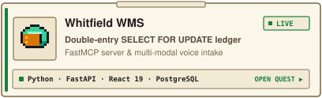
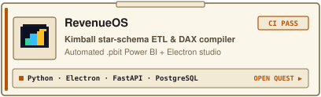
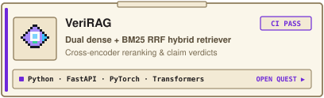
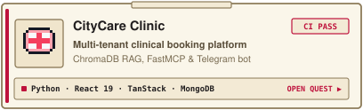
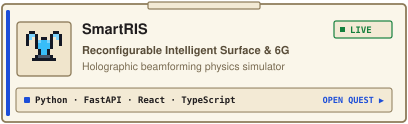
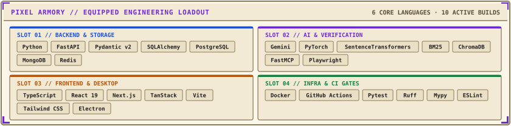

  <picture>
    <source media="(prefers-color-scheme: dark)" srcset="https://raw.githubusercontent.com/25sarvesh2005/25sarvesh2005/output/assets/hero-dark.svg" />
    <source media="(prefers-color-scheme: light)" srcset="https://raw.githubusercontent.com/25sarvesh2005/25sarvesh2005/output/assets/hero-light.svg" />
    
  </picture>

  <picture>
    <source media="(prefers-color-scheme: dark)" srcset="https://raw.githubusercontent.com/25sarvesh2005/25sarvesh2005/output/assets/battle-dark.svg" />
    <source media="(prefers-color-scheme: light)" srcset="https://raw.githubusercontent.com/25sarvesh2005/25sarvesh2005/output/assets/battle-light.svg" />
    
  </picture>

  
  &nbsp;
  
  &nbsp;
  
  &nbsp;
  

  <b>Play the Raid:</b> Click any cartridge button above -> submit the pre-filled Issue -> GitHub Actions executes your roll in ~15s. Every new GitHub commit also strikes the boss automatically.

  <picture>
    <source media="(prefers-color-scheme: dark)" srcset="https://raw.githubusercontent.com/25sarvesh2005/25sarvesh2005/output/assets/trainer-dark.svg" />
    <source media="(prefers-color-scheme: light)" srcset="https://raw.githubusercontent.com/25sarvesh2005/25sarvesh2005/output/assets/trainer-light.svg" />
    
  </picture>

<h3 align="center">Featured Quest Cartridges (Click Any Cartridge to Inspect)</h3>

  <a href="https://github.com/25sarvesh2005/REPO-Score">
    <picture>
      <source media="(prefers-color-scheme: dark)" srcset="https://raw.githubusercontent.com/25sarvesh2005/25sarvesh2005/output/assets/quest-reposcore-dark.svg" />
      <source media="(prefers-color-scheme: light)" srcset="https://raw.githubusercontent.com/25sarvesh2005/25sarvesh2005/output/assets/quest-reposcore-light.svg" />
      
    </picture>
  </a>
  &nbsp;
  <a href="https://github.com/25sarvesh2005/WAREHOUSE-MANAGEMENT-SYSTEM">
    <picture>
      <source media="(prefers-color-scheme: dark)" srcset="https://raw.githubusercontent.com/25sarvesh2005/25sarvesh2005/output/assets/quest-whitfield-wms-dark.svg" />
      <source media="(prefers-color-scheme: light)" srcset="https://raw.githubusercontent.com/25sarvesh2005/25sarvesh2005/output/assets/quest-whitfield-wms-light.svg" />
      
    </picture>
  </a>
   
  <a href="https://github.com/25sarvesh2005/RevenueOS">
    <picture>
      <source media="(prefers-color-scheme: dark)" srcset="https://raw.githubusercontent.com/25sarvesh2005/25sarvesh2005/output/assets/quest-revenueos-dark.svg" />
      <source media="(prefers-color-scheme: light)" srcset="https://raw.githubusercontent.com/25sarvesh2005/25sarvesh2005/output/assets/quest-revenueos-light.svg" />
      
    </picture>
  </a>
  &nbsp;
  <a href="https://github.com/25sarvesh2005/VeriRAG">
    <picture>
      <source media="(prefers-color-scheme: dark)" srcset="https://raw.githubusercontent.com/25sarvesh2005/25sarvesh2005/output/assets/quest-verirag-dark.svg" />
      <source media="(prefers-color-scheme: light)" srcset="https://raw.githubusercontent.com/25sarvesh2005/25sarvesh2005/output/assets/quest-verirag-light.svg" />
      
    </picture>
  </a>
   
  <a href="https://github.com/25sarvesh2005/CityCareClinic">
    <picture>
      <source media="(prefers-color-scheme: dark)" srcset="https://raw.githubusercontent.com/25sarvesh2005/25sarvesh2005/output/assets/quest-citycare-dark.svg" />
      <source media="(prefers-color-scheme: light)" srcset="https://raw.githubusercontent.com/25sarvesh2005/25sarvesh2005/output/assets/quest-citycare-light.svg" />
      
    </picture>
  </a>
  &nbsp;
  <a href="https://github.com/25sarvesh2005/SMARTRIS">
    <picture>
      <source media="(prefers-color-scheme: dark)" srcset="https://raw.githubusercontent.com/25sarvesh2005/25sarvesh2005/output/assets/quest-smartris-dark.svg" />
      <source media="(prefers-color-scheme: light)" srcset="https://raw.githubusercontent.com/25sarvesh2005/25sarvesh2005/output/assets/quest-smartris-light.svg" />
      
    </picture>
  </a>

  Live Deployments: <a href="https://warehouse-management-system-jade-seven.vercel.app">Whitfield WMS</a> · <a href="https://smartris.vercel.app">SmartRIS 6G Simulator</a>

  <picture>
    <source media="(prefers-color-scheme: dark)" srcset="https://raw.githubusercontent.com/25sarvesh2005/25sarvesh2005/output/assets/armory-dark.svg" />
    <source media="(prefers-color-scheme: light)" srcset="https://raw.githubusercontent.com/25sarvesh2005/25sarvesh2005/output/assets/armory-light.svg" />
    
  </picture>

  <picture>
    <source media="(prefers-color-scheme: dark)" srcset="https://raw.githubusercontent.com/25sarvesh2005/25sarvesh2005/output/assets/snake-banner-dark.svg" />
    <source media="(prefers-color-scheme: light)" srcset="https://raw.githubusercontent.com/25sarvesh2005/25sarvesh2005/output/assets/snake-banner-light.svg" />
    
  </picture>
  <picture>
    <source media="(prefers-color-scheme: dark)" srcset="https://raw.githubusercontent.com/25sarvesh2005/25sarvesh2005/output/assets/snake-dark.svg" />
    <source media="(prefers-color-scheme: light)" srcset="https://raw.githubusercontent.com/25sarvesh2005/25sarvesh2005/output/assets/snake-light.svg" />
    
  </picture>

<b>Verified Telemetry Rules, XP Curve & Auto-Sync Pipeline</b>

All stats, RPG meters, Quest Cartridges, badges, and Boss Synergy damage come strictly from [GitHub Actions](.github/workflows/refresh-profile.yml) + [`scripts/compute_gamification.py`](scripts/compute_gamification.py), counting **only repositories owned by `@25sarvesh2005`** (forked repos, collaborator repos, and self-stars are excluded).

- **Auto-Sync Schedule:** Runs every **20 minutes** (`7,27,47 * * * *`) + `workflow_dispatch` to sync live contributions, Trophy Case, Quest Cartridges, and the Contribution Snake onto the `output` branch (commits only when metrics or SVGs change).
- **XP Formula:** `(Contributions × 2) + (Active Days × 5) + (Merged PRs × 35) + (Documented Repos × 40) + (CI Repos × 60) + (External Stars × 25) + (Languages ≥1% × 50)`
- **Level Curve:** `Level = floor(sqrt(XP / 20)) + 1`
- **Commit Synergy:** Whenever new real GitHub contributions appear during scheduled syncs, [`scripts/game_engine.py`](scripts/game_engine.py) deals `delta × 3 DMG` to the active dungeon boss.

