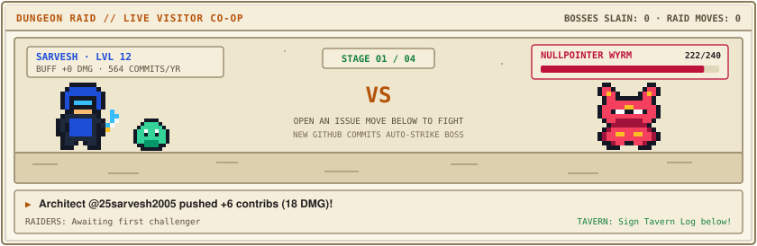

### Sarvesh Sharma

I build backend-heavy AI systems, financial/inventory engines, and full-stack web tools—mostly in **Python**, **FastAPI**, **TypeScript**, and **PostgreSQL**. My focus is making automated software reliable under real failure modes: row-locked ledgers, sandboxed static analysis, citation-grounded RAG, and reproducible CI.

- **Reach me:** [sarvesh.sh7890@gmail.com](mailto:sarvesh.sh7890@gmail.com)
- **Live deployments:** [Whitfield WMS](https://warehouse-management-system-jade-seven.vercel.app) · [SmartRIS 6G Simulator](https://smartris.vercel.app)

---

### Interactive Boss Raid

  <picture>
    <source media="(prefers-color-scheme: dark)" srcset="https://raw.githubusercontent.com/25sarvesh2005/25sarvesh2005/output/assets/battle-dark.svg" />
    <source media="(prefers-color-scheme: light)" srcset="https://raw.githubusercontent.com/25sarvesh2005/25sarvesh2005/output/assets/battle-light.svg" />
    
  </picture>

  
  &nbsp;
  
  &nbsp;
  
  &nbsp;
  

  Click any move above and submit the pre-filled Issue—GitHub Actions runs [`scripts/game_engine.py`](scripts/game_engine.py), posts the combat roll, closes the Issue, and re-renders the arena in ~15 seconds.

---

### Selected Engineering Work

| System | Architecture & Engineering Focus | Stack | Commits |
| :--- | :--- | :--- | :--- |
| [**WAREHOUSE-MANAGEMENT-SYSTEM**](https://github.com/25sarvesh2005/WAREHOUSE-MANAGEMENT-SYSTEM) · [Live](https://warehouse-management-system-jade-seven.vercel.app) | Multi-tenant double-entry inventory engine using PostgreSQL `SELECT FOR UPDATE` concurrency locks, FastMCP server tools, and voice intake | Python · FastAPI · React 19 · TypeScript · PostgreSQL | 99 |
| [**REPO-Score**](https://github.com/25sarvesh2005/REPO-Score) | Isolated Docker execution sandbox + AST/Semgrep/OSV static & security analyzers driving a deterministic 10-dimension repository scorer | Python · FastAPI · Next.js · Docker · Redis | 57 |
| [**RevenueOS**](https://github.com/25sarvesh2005/RevenueOS) | Automated Kimball star-schema ETL, DAX/`.pbit` Power BI workbook compiler, anomaly detector, and packaged Electron desktop UI | Python · Electron · FastAPI · PostgreSQL | 27 |
| [**CityCareClinic**](https://github.com/25sarvesh2005/CityCareClinic) | Multi-tenant clinical scheduling platform unified across React 19 web app, ChromaDB RAG, FastMCP server, and Telegram patient bot | Python · React 19 · TanStack · MongoDB | 20 |
| [**SMARTRIS**](https://github.com/25sarvesh2005/SMARTRIS) · [Live](https://smartris.vercel.app) | Reconfigurable Intelligent Surface (RIS) & 6G holographic beamforming simulator validated across Python 3.11–3.13 + Vite CI gates | Python · FastAPI · React · TypeScript | 11 |
| [**VeriRAG**](https://github.com/25sarvesh2005/VeriRAG) | Dual dense + BM25 Reciprocal Rank Fusion retriever with cross-encoder reranking and claim-level entailment checks | Python · FastAPI · PyTorch · SentenceTransformers | 8 |

Other public builds: [**telephony_ai**](https://github.com/25sarvesh2005/telephony_ai) (FastAPI + SQLAlchemy outbound recovery telephony), [**AIAUTOPILOT_FORM**](https://github.com/25sarvesh2005/AIAUTOPILOT_FORM) (Electron + Playwright + Gemini document-to-form automation), and [**canteenapp**](https://github.com/25sarvesh2005/canteenapp) (Kotlin + Jetpack Compose + Firebase Android app).

---

### Core Stack

- **Backend & Data:** Python, FastAPI, Pydantic v2, SQLAlchemy, Alembic, PostgreSQL, MongoDB, Redis
- **AI & Verification:** Google Gemini, PyTorch, SentenceTransformers, BM25, ChromaDB, FastMCP, Playwright
- **Frontend & Desktop:** TypeScript, React 18/19, Next.js, TanStack, Vite, Tailwind CSS, Electron
- **Testing & Delivery:** Docker, GitHub Actions, Pytest, Ruff, Mypy, ESLint

---

### GitHub Telemetry & Milestones

  <picture>
    <source media="(prefers-color-scheme: dark)" srcset="https://raw.githubusercontent.com/25sarvesh2005/25sarvesh2005/output/assets/trainer-dark.svg" />
    <source media="(prefers-color-scheme: light)" srcset="https://raw.githubusercontent.com/25sarvesh2005/25sarvesh2005/output/assets/trainer-light.svg" />
    
  </picture>

How telemetry &amp; boss sync work

[`scripts/fetch_github_data.py`](scripts/fetch_github_data.py) and [`scripts/compute_gamification.py`](scripts/compute_gamification.py) aggregate only repositories owned by `@25sarvesh2005` (excluding forks, external collaborator repos, and self-stars) on a 20-minute cron in [`.github/workflows/refresh-profile.yml`](.github/workflows/refresh-profile.yml).

- **XP formula:** `(Contributions × 2) + (Active Days × 5) + (Merged PRs × 35) + (Documented Repos × 40) + (CI Repos × 60) + (External Stars × 25) + (Languages ≥1% × 50)`
- **Level curve:** `floor(sqrt(XP / 20)) + 1`
- **Commit synergy:** New contributions detected between syncs deal `delta × 3 DMG` to the active raid boss.

---

### Contribution Activity

  <picture>
    <source media="(prefers-color-scheme: dark)" srcset="https://raw.githubusercontent.com/25sarvesh2005/25sarvesh2005/output/assets/snake-dark.svg" />
    <source media="(prefers-color-scheme: light)" srcset="https://raw.githubusercontent.com/25sarvesh2005/25sarvesh2005/output/assets/snake-light.svg" />
    
  </picture>

