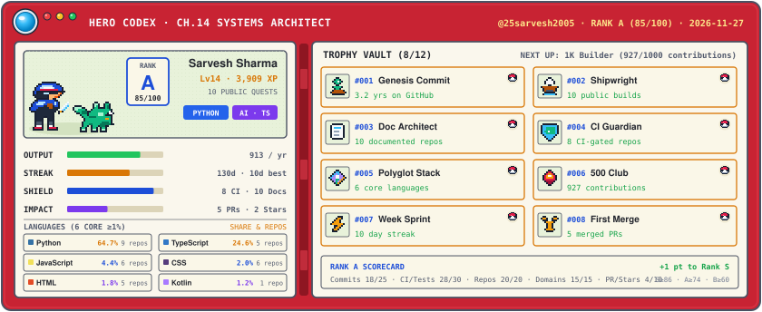

  <picture>
    <source media="(prefers-color-scheme: dark)" srcset="https://raw.githubusercontent.com/25sarvesh2005/25sarvesh2005/output/assets/battle-dark.svg" />
    <source media="(prefers-color-scheme: light)" srcset="https://raw.githubusercontent.com/25sarvesh2005/25sarvesh2005/output/assets/battle-light.svg" />
    
  </picture>

  
  &nbsp;
  
  &nbsp;
  
  &nbsp;
  

  <b>How to Play:</b> Click any pixel command above, hit <b>Create</b> on the pre-filled issue, and GitHub Actions executes your move (~15s) and closes the issue with your combat roll. Every new commit I ship also strikes the active boss.

---

> **Sarvesh Sharma (`@25sarvesh2005`)** — I build **verifiable AI pipelines, sandboxed software analyzers, and full-stack operational engines** in **Python**, **TypeScript**, and **FastAPI**. I care about systems that prove what they emit: deterministic scoring, row-locked financial/inventory ledgers, and real CI gates.

  <picture>
    <source media="(prefers-color-scheme: dark)" srcset="https://raw.githubusercontent.com/25sarvesh2005/25sarvesh2005/output/assets/trainer-dark.svg" />
    <source media="(prefers-color-scheme: light)" srcset="https://raw.githubusercontent.com/25sarvesh2005/25sarvesh2005/output/assets/trainer-light.svg" />
    
  </picture>

---

### Selected Quests & Systems

| Build | What It Actually Does | Core Loadout | Links |
| :--- | :--- | :--- | :--- |
| [**RepoScore**](https://github.com/25sarvesh2005/REPO-Score) | Hardened Docker sandbox + AST/Semgrep/OSV evaluation with deterministic 10-dimension scoring | Python · FastAPI · Next.js · Docker · Postgres · Redis | [Source](https://github.com/25sarvesh2005/REPO-Score) |
| [**Whitfield WMS**](https://github.com/25sarvesh2005/WAREHOUSE-MANAGEMENT-SYSTEM) | Double-entry inventory ledger, `SELECT FOR UPDATE` concurrency, FastMCP server & voice intake | Python · FastAPI · React 19 · TypeScript · PostgreSQL | [Source](https://github.com/25sarvesh2005/WAREHOUSE-MANAGEMENT-SYSTEM) · [Live](https://warehouse-management-system-jade-seven.vercel.app) |
| [**RevenueOS**](https://github.com/25sarvesh2005/RevenueOS) | Kimball star-schema ETL, DAX/Power BI `.pbit` compiler & Electron studio | Python · Electron · FastAPI · PostgreSQL · Chart.js | [Source](https://github.com/25sarvesh2005/RevenueOS) |
| [**VeriRAG**](https://github.com/25sarvesh2005/VeriRAG) | Dual-channel dense + BM25 RRF retrieval, cross-encoder reranking & claim entailment verdicts | Python · FastAPI · PyTorch · SentenceTransformers | [Source](https://github.com/25sarvesh2005/VeriRAG) |
| [**CityCare Clinic**](https://github.com/25sarvesh2005/CityCareClinic) | Multi-tenant clinical scheduling, ChromaDB RAG, FastMCP & Telegram patient bot | Python · React 19 · TanStack · MongoDB · FastMCP | [Source](https://github.com/25sarvesh2005/CityCareClinic) |
| [**SmartRIS**](https://github.com/25sarvesh2005/SMARTRIS) | Reconfigurable Intelligent Surface (RIS) & 6G holographic beamforming physics simulator | Python · FastAPI · React · TypeScript · NumPy | [Source](https://github.com/25sarvesh2005/SMARTRIS) · [Live](https://smartris.vercel.app) |

---

### Equipped Tech Loadout

| Slot | Verified Tools |
| :--- | :--- |
| **Backend & Storage** | `Python` · `FastAPI` · `Pydantic v2` · `SQLAlchemy` · `Alembic` · `PostgreSQL` · `MongoDB` · `Redis` |
| **AI & Verification** | `Google Gemini` · `PyTorch` · `SentenceTransformers` · `BM25` · `ChromaDB` · `FastMCP` · `Playwright` |
| **Frontend & Desktop** | `TypeScript` · `React 18/19` · `Next.js` · `TanStack Start/Router` · `Vite` · `Tailwind CSS` · `Electron` |
| **Infra & QA** | `Docker` · `GitHub Actions CI` · `Pytest` · `Ruff` · `Mypy` · `ESLint` |

---

<b>How XP, Pixel Badges & Boss Damage Are Verified (Zero Fake Stats)</b>

All stats and pixel badges in the Trainer Card come strictly from [GitHub Actions](.github/workflows/refresh-profile.yml) + [`scripts/compute_gamification.py`](scripts/compute_gamification.py), counting **only repositories owned by `@25sarvesh2005`** (collaborator/forked repos and self-stars are excluded).

- **XP Formula:** `(Contributions × 2) + (Active Days × 5) + (Merged PRs × 35) + (Documented Repos × 40) + (CI Repos × 60) + (External Stars × 25) + (Languages ≥1% × 50)`
- **Level Curve:** `Level = floor(sqrt(XP / 20)) + 1`
- **Commit Synergy:** Whenever new real GitHub contributions appear during scheduled syncs, [`scripts/game_engine.py`](scripts/game_engine.py) deals `delta × 3 DMG` to the active dungeon boss.

---

  <picture>
    <source media="(prefers-color-scheme: dark)" srcset="https://raw.githubusercontent.com/25sarvesh2005/25sarvesh2005/output/assets/snake-dark.svg" />
    <source media="(prefers-color-scheme: light)" srcset="https://raw.githubusercontent.com/25sarvesh2005/25sarvesh2005/output/assets/snake-light.svg" />
    
  </picture>

