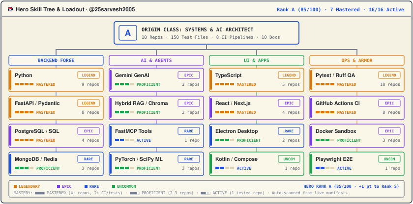

## Sarvesh Sharma · Systems & AI Engineer

I build backend systems, data/BI engines, and applied AI tools in **Python**, **TypeScript**, **FastAPI**, and **PostgreSQL**—focused on concurrency safety, deterministic evaluation, and reproducible CI.

[sarvesh.sh7890@gmail.com](mailto:sarvesh.sh7890@gmail.com) · **Live:** [Whitfield WMS](https://warehouse-management-system-jade-seven.vercel.app) · [SmartRIS 6G Simulator](https://smartris.vercel.app)

---

### Interactive Boss Raid

  <picture>
    <source media="(prefers-color-scheme: dark)" srcset="https://raw.githubusercontent.com/25sarvesh2005/25sarvesh2005/output/assets/battle-dark.svg" />
    <source media="(prefers-color-scheme: light)" srcset="https://raw.githubusercontent.com/25sarvesh2005/25sarvesh2005/output/assets/battle-light.svg" />
    
  </picture>

  
  &nbsp;
  
  &nbsp;
  
  &nbsp;
  
  &nbsp;
  

  <b>Star</b> <code>25sarvesh2005/25sarvesh2005</code> (top-right ★) for an <b>instant 1-Hit Boss KO</b> (~15s), or pick an Issue command above to roll damage / sign the guestbook. Stars on any owned repo &amp; new commits also damage or KO the active boss.

---

### Selected Engineering Work

| System | Engineering Focus | Primary Stack | Verification |
| :--- | :--- | :--- | :--- |
| [**Whitfield WMS**](https://github.com/25sarvesh2005/WAREHOUSE-MANAGEMENT-SYSTEM) · [Live](https://warehouse-management-system-jade-seven.vercel.app) | Multi-tenant double-entry inventory engine using PostgreSQL `SELECT FOR UPDATE` row locking, FastMCP server tools, and voice intake | Python · FastAPI · React 19 · TypeScript · PostgreSQL | Live · CI |
| [**RepoScore**](https://github.com/25sarvesh2005/REPO-Score) | Isolated Docker execution sandbox + AST/Semgrep/OSV static & security checks driving a deterministic 10-dimension repository scorer | Python · FastAPI · Next.js · Docker · Redis | CI · MIT |
| [**RevenueOS**](https://github.com/25sarvesh2005/RevenueOS) | Automated Kimball star-schema ETL, DAX/`.pbit` Power BI workbook compiler, anomaly detection, and packaged Electron desktop UI | Python · Electron · FastAPI · PostgreSQL | CI · Desktop |
| [**CityCareClinic**](https://github.com/25sarvesh2005/CityCareClinic) | Multi-tenant clinical scheduling platform unified across a React 19 app, ChromaDB RAG, FastMCP server, and Telegram patient bot | Python · React 19 · TanStack · MongoDB | CI · MIT |
| [**SmartRIS**](https://github.com/25sarvesh2005/SMARTRIS) · [Live](https://smartris.vercel.app) | Reconfigurable Intelligent Surface (RIS) & 6G holographic beamforming physics simulator | Python · FastAPI · React · TypeScript | Live · CI |
| [**VeriRAG**](https://github.com/25sarvesh2005/VeriRAG) | Dual dense + BM25 Reciprocal Rank Fusion retriever with cross-encoder reranking and claim-level entailment checks | Python · FastAPI · PyTorch · SentenceTransformers | CI · MIT |

Additional shipped projects: [**telephony_ai**](https://github.com/25sarvesh2005/telephony_ai) (FastAPI + SQLAlchemy outbound recovery telephony), [**AIAUTOPILOT_FORM**](https://github.com/25sarvesh2005/AIAUTOPILOT_FORM) (Electron + Playwright + Gemini document-to-form automation), and [**canteenapp**](https://github.com/25sarvesh2005/canteenapp) (Kotlin + Jetpack Compose + Firebase Android app).

---

### Pokédex · Player Stats, Grade & Language Matrix

  <picture>
    <source media="(prefers-color-scheme: dark)" srcset="https://raw.githubusercontent.com/25sarvesh2005/25sarvesh2005/output/assets/trainer-dark.svg" />
    <source media="(prefers-color-scheme: light)" srcset="https://raw.githubusercontent.com/25sarvesh2005/25sarvesh2005/output/assets/trainer-light.svg" />
    
  </picture>

### GBA Skill Tree · Rarity & Mastery Status

  <picture>
    <source media="(prefers-color-scheme: dark)" srcset="https://raw.githubusercontent.com/25sarvesh2005/25sarvesh2005/output/assets/skill_tree-dark.svg" />
    <source media="(prefers-color-scheme: light)" srcset="https://raw.githubusercontent.com/25sarvesh2005/25sarvesh2005/output/assets/skill_tree-light.svg" />
    
  </picture>

Grade rubric, skill mastery rules &amp; 20-minute sync details

[`scripts/fetch_github_data.py`](scripts/fetch_github_data.py) and [`scripts/compute_gamification.py`](scripts/compute_gamification.py) aggregate only public repositories owned by `@25sarvesh2005` (excluding forks, external collaborator repos, and self-stars) every 20 minutes via [`.github/workflows/refresh-profile.yml`](.github/workflows/refresh-profile.yml), reading real git trees, test files, CI workflows, and dependency manifests (`requirements.txt`, `pyproject.toml`, `package.json`, `libs.versions.toml`).

- **Grade (`0–100`):** `Output & Consistency (25)` + `CI, Testing & Docs (30)` + `Codebase Depth & Languages (20)` + `Skill Breadth (15)` + `PRs & External Stars (10)` → `S+ ≥ 94`, `S ≥ 86`, `A ≥ 74`, `B ≥ 60`, `C < 60`.
- **Skill Mastery:** `MASTERED` (`4+` repos & `2+` CI/tested) · `PROFICIENT` (`2–3` verified repos) · `ACTIVE` (`1` tested/shipped repo) · `EXPLORING` (manifest only).
- **XP & Raid Combat:** `(Contributions × 2) + (Active Days × 5) + (Merged PRs × 35) + (Documented Repos × 40) + (CI Repos × 60) + (External Stars × 25) + (Languages ≥1% × 50)`. Starring `25sarvesh2005/25sarvesh2005` triggers an instant **1-Hit KO** via GitHub Actions `watch`; new portfolio stars also trigger KOs during syncs, and new commits deal `delta × 3 DMG`.

---

### Contribution Activity

  <picture>
    <source media="(prefers-color-scheme: dark)" srcset="https://raw.githubusercontent.com/25sarvesh2005/25sarvesh2005/output/assets/snake-dark.svg" />
    <source media="(prefers-color-scheme: light)" srcset="https://raw.githubusercontent.com/25sarvesh2005/25sarvesh2005/output/assets/snake-light.svg" />
    
  </picture>

